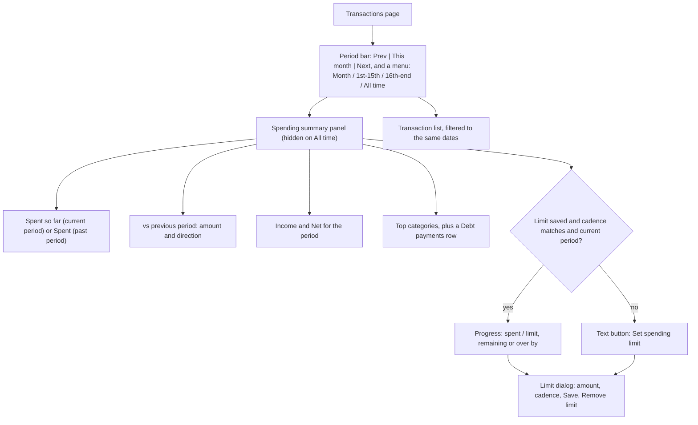
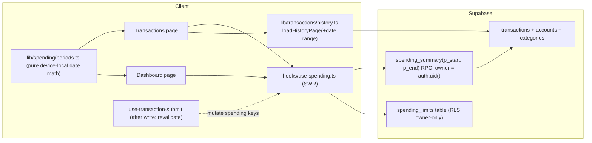
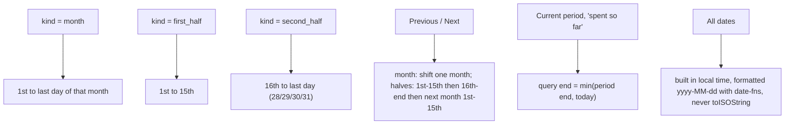

# Spending Summary + Optional Limit on Transactions: Implementation Plan

**Status:** Tasks 1–7 implemented and reviewed; local Task 8 QA complete. Production release gate remains pending. Sol6.1 low/medium handled integration and review; Luna max handled small coding units, with Sol low fallback after Luna's usage limit. No production SQL, merge or push is authorized by this approval. Preserve unrelated changes.

**User copy override (October 15):** Keep the summary concise, especially on mobile. Show “Expenses + card payments” and one “Totals” date range; place accounting and list-scope explanations inside a default-collapsed “How totals work” disclosure. This supersedes the always-visible explanatory paragraphs below without changing accounting behavior.

**Requirements:** This document records the approved spending-summary requirements and calendar-half model from the conversation. Use browser-local calendar and All time default. Earlier external drafts are superseded by this repository copy.

> **For agentic workers:** use `subagent-driven-development` (recommended) or `executing-plans` to carry this out task by task. Read `.agents/skills/antislop/SKILL.md`, `antislop-ui`, `antislop-layoutmobile` and `antislop-human` before any UI task (antislop mode: **during**). Steps use checkboxes for tracking.

**Goal:** Let any Monetigia user pick a period on the Transactions page (a month or a cutoff half) and see how much they spent in it, how that compares to the previous period, and where the money went. Users who want a cap can also save an optional spending limit (for example ₱6,000 per cutoff) that is shown, never enforced.

**Architecture:** One owner-scoped SQL function computes the whole period on the server, so totals are always complete and never depend on the 50-row paging. A small `spending_limits` table holds one optional limit per user. A pure period helper builds device-local calendar date ranges and replaces the Dashboard's UTC date math, so Dashboard and Transactions show the same numbers.

**Tech stack:** Next.js 14 (App Router, client components), Supabase (Postgres + RLS + RPC), SWR, date-fns, Vitest + Testing Library, `node --test` DB suites.

**Source of requirements:** the chat with the user, plus `Downloads/Untitled.md` (Astra review points #4 future-dated expenses and #6 Dashboard consistency are covered here; the rest belong to the deferred full Budgets feature).

---

## User Review Required

> [!IMPORTANT]
> **Default view: All time.** Preserve the existing full-history default. Selecting Month or a cutoff enables the period summary and filters search/type chips to that range. Switching back to All time removes the summary.

> [!WARNING]
> **The Dashboard's numbers may shift slightly once this ships.** Two existing problems get fixed along the way:
> 1. `getDateRange` in [dashboard/page.tsx](file:///c:/Users/PC/Documents/monetigia/src/app/(dashboard)/dashboard/page.tsx#L34-L48) builds dates with `toISOString()` (UTC). In UTC+8 that probably makes "This month" start on the last day of the previous month and end yesterday. **This is from reading the code only; Task 1 confirms it with a failing test before anything changes.**
> 2. [`useDashboardStats`](file:///c:/Users/PC/Documents/monetigia/src/hooks/use-data.ts#L69-L157) fetches raw rows with no limit. Supabase caps responses (1000 rows by default), so very busy periods can be undercounted without any error. The new server-side total removes that cap.

## Open Questions

> [!IMPORTANT]
> **Q1. How should a cutoff be split?** The plan assumes **calendar halves: 1st–15th and 16th–end of month**. It's simple, it's the same for every user, and it has no edge cases around paydays. The alternative is **payday to payday (15th until the day before month-end, then month-end until the 14th)**. That matches salary timing more closely but needs its own boundary rules and tests (Feb 28/29, months with 30 vs 31 days). Calendar halves unless you say otherwise.
>
> **Answer (user, Oct 14): 1st–15th, then 16th onwards to the end of the month.** That's the calendar-halves model the plan already uses (`first_half` = 1–15, `second_half` = 16 to the last day of the month), so Task 1 and Task 7 stay as written. Payday-to-payday is out of scope.

> [!IMPORTANT]
> **Q2. Is the pending rollout finished?** [2026-10-08-remaining-rollout-execution.md](file:///c:/Users/PC/Documents/monetigia/docs/superpowers/plans/2026-10-08-remaining-rollout-execution.md) still has 37 unchecked boxes, but the description-edit migrations it describes are already in `supabase/migrations`. Confirm the boxes are just stale. Otherwise this work should wait so the two don't collide in `transactions/page.tsx`.
>
> **Answer (checked Oct 14, corrected Oct 15): Tasks 7–8 are implemented and the unchecked boxes are stale. Implementation can start. Production rollout is still gated.**
>
> | Rollout unit | Status | Evidence |
> |---|---|---|
> | 7.1 Stable selection + correction confirmation | Done | commit `e6888d3` |
> | 7.2 Purchase and opening-debt consumers | Done, reviewed | commit `2bdd3e0`, `task-7-2-review.md` |
> | 8.1 Guarded description command | Done, reviewed | commit `d7714f3`, `task-8-1-review.md` |
> | 8.2 Description editors in history | Done, reviewed | commit `495465c`, `task-8-2-review.md`; review fix `f26b845` |
> | 9.1 Automated verification | Green | [PENDING_ROLLOUT_VERIFICATION.md](file:///c:/Users/PC/Documents/monetigia/docs/codex-review/PENDING_ROLLOUT_VERIFICATION.md): 7 Node + 429 Vitest + 135 DB tests, typecheck, build |
> | 9.2 Rendered/device acceptance | **Partial** | Browser screenshots recorded. Still pending: physical Safari/PWA (Home Screen), true 200% zoom, safe-area/keyboard, production tab-return recovery |
> | Production migrations through `202610090001_transaction_metadata.sql` | **User-reported production installation succeeded; live migration/function parity still needs verification.** | After the handoff doc was written, the user ran the migration bundle and reported debt objects/access `true` and `transaction_metadata_installed` `true`. [BETA_1_1_HANDOFF.md](file:///c:/Users/PC/Documents/monetigia/docs/codex-review/BETA_1_1_HANDOFF.md) line 11 predates that run and is outdated on this point. This is not automatic proof that every function body and grant matches the repo. |
>
> Sources: the commit log, the review docs, the two handoff docs, and the user's production report (Oct 15 correction). The rollout plan's own boxes were never updated after execution.
>
> **What this means for this plan:**
> - No unfinished Tasks 7–8 implementation blocks this feature. Start from current HEAD, inspect concurrent changes, and preserve existing transaction editors, pagination, selection and refresh behavior.
> - **Implementation can start now.** Nothing from Tasks 7–8 needs to be repeated or waited for.
> - **Production rollout stays gated** on (a) actual live schema checks, meaning catalog-level confirmation that the deployed functions, grants and tables match the ordered migrations, and (b) this feature's own QA (Task 8). Physical Safari/PWA acceptance from 9.2 is still pending and stays on the rollout track. This feature's UI must not deploy before its own migrations ("migration before dependent frontend"). Task 8 has the step (below).
> - **Not in this plan's scope:** finishing the 9.2 device checks, ticking the old checkboxes, or repairing `schema.sql` parity (audit M03, see Task 2).

> [!NOTE]
> **Q3 (default chosen, change if you want).** A limit has one cadence: **Monthly** or **Per cutoff**. It shows progress only on the **current** period of that cadence. Past periods show what was spent, without the limit, because the limit could have been different back then. This avoids building limit history now.

---

## What the user sees

**Layout notes (antislop "during"):**
- No `DESIGN.md` exists for the app, so the **existing app's visual system is the direction**: reuse `summaryPanelClass`, `summaryAmountClass` and the divider pattern from [financial-summary.tsx](file:///c:/Users/PC/Documents/monetigia/src/components/ui/financial-summary.tsx), the existing theme tokens, and existing `Button` variants. No new colors, gradients, glows or badges.
- The screen's job is answering "how much have I spent this period and how much is left". So **Spent** gets the biggest number, the limit progress sits right under it, and income/net are secondary. Not four equal stat cards.
- The progress bar fill uses the `primary` token; when over the limit, the bar and the "over by" text use the `destructive` token. The limit dialog's Save button is `variant="default"` (per AGENTS.md).
- Mobile (320/375): the period bar is one row (prev arrow, label, next arrow, menu). The summary stacks vertically. All controls are at least 44px tall. No horizontal scroll.
- Copy has no em dashes. Exact strings are in Task 6 and Task 7.

---

## Architecture

### Spending rules (one definition, used everywhere)

These copy what `useDashboardStats` does today, so totals stay consistent:

| Transaction | Counted as | Why |
|---|---|---|
| Expense from a non-credit wallet (cash, bank, e_wallet, investment) | **Spent**, in its category (no category becomes "Uncategorized") | Real money left a wallet |
| Expense on a credit card account | **Not counted** | Counted later, when the card is paid |
| Transfer from a non-credit wallet **to a credit card** | **Spent**, in a separate **Debt payments** bucket | The cash moment of card spending; counted exactly once |
| Transfer between non-credit wallets | **Not counted** | Money just moved between wallets |
| Income into a non-credit wallet | **Income** | Same rule as the Dashboard |
| Expense linked to a goal (`goal_id` set) | **Spent only if its source wallet is non-credit** | Goal tagging does not override the credit-purchase exclusion |
| Any row dated after **today** | **Not counted yet** (current period only) | Astra #4: future-dated rows count once their date arrives |

Dates use `transactions.date` (for installments, that's the due date), never `created_at` or `purchase_date`.

### Period rules

**Calendar policy:** Use the device/browser-local civil date consistently with `toLocalDateInputValue` in the existing transaction form. Do not force Asia/Manila in the summary alone. Stored DATE strings remain civil dates, not UTC timestamps. Verify Manila, Tokyo and Los Angeles with the same instant and local midnight boundaries. A shared `useLocalToday` hook recomputes at local midnight, focus and visibility return; background timer throttling must not leave a stale day. Reuse the existing form helper without adding a hooks-to-component dependency cycle. Do not silently change an already edited transaction date when midnight passes.

**Navigation:** All time is the initial state. Selecting a period kind opens its current period. Disable Next when its candidate would start after today; disable period arrows on All time. Defensively avoid any RPC request with start after queryEnd. A future period is not an error or a fabricated zero total.

**Comparison:** For a current period, compare the same elapsed number of calendar days from the previous period's start, capped at that period's end. For a past period, compare full period against full previous period. Cutoff comparisons use sequential halves, not the same half in the prior month. Example: Oct 16 alone compares with Oct 1 alone; Oct 1–15 compares with Sep 16–30. Labels show the exact compared dates. Add `comparisonRange(period, today): { start: string; end: string }`; fetch both ranges in `useSpendingSummary` and return current/comparison data with independent failure handling. A comparison failure must not hide a valid current total or imply zero previous spending.

---

## Global Constraints

- No new npm dependencies (date-fns, SWR, Radix are already installed).
- No change to how transactions, wallets, goals or debt are written. This feature only reads them, plus one new table for the limit.
- A limit is **informational**: no write path anywhere checks it.
- Every new SQL object has `search_path = pg_catalog, public`. Grant to `authenticated` only and revoke from `PUBLIC` and `anon`. RLS uses owner-only policies, following the existing migration style.
- **Ordered migrations in `supabase/migrations/` are the only authoritative schema path.** Do not append to or edit `supabase/schema.sql`. Per [audit M03](file:///c:/Users/PC/Documents/monetigia/docs/AUDIT_REPORT_gpt.md#L63), it only contains the first six Oct 6 migrations plus an old grant sweep, and reapplying it downgrades a current backend. Appending this feature's objects wouldn't restore the missing debt/archive/history/metadata contracts and would make the file look more current than it is. Schema parity is fixed separately, outside this plan.
- **New migrations must install identically with LF or CRLF line endings** ([audit M25](file:///c:/Users/PC/Documents/monetigia/docs/AUDIT_REPORT_gpt.md#L445)). Use plain `CREATE TABLE IF NOT EXISTS` / `CREATE OR REPLACE FUNCTION` statements. No dynamic exact-body text replacement of existing functions.
- Money is handled as 2-decimal strings from SQL and converted with the existing minor-unit helpers. No float sums for displayed totals.
- UI text: English, no em dashes, specific labels (antislop R-02, R-15).
- Primary buttons use `variant="default"`; no hardcoded green shades (AGENTS.md).

## Review Focus

Most likely failure modes no single test naturally hits, and where each one gets pinned:

1. **A PH user opening the app just after midnight on the 1st sees the wrong month.** Pinned in Task 1 (tests run with `TZ=Asia/Manila`, clock set to 00:30 on the 1st).
2. **Dashboard and Transactions show different "This month" spent.** Pinned in Task 5 (both read the same RPC with the same range; parity test).
3. **A month with more than 1000 transactions is undercounted.** Pinned in Task 2 (DB test inserts 1,200 rows; the total must be exact).
4. **An installment group is partly inside the period.** The list keeps the complete group card (debt correction needs every sibling), but the summary only counts children dated inside the period. Pinned in Task 6.
5. **The user adds or deletes a transaction and the summary is stale.** Pinned in Task 4 (revalidation after the submit/delete hooks succeed).

---

## Proposed Changes

### Task 1: Period helper and confirming the Dashboard date bug

**Files**
- Create: `src/lib/spending/periods.ts`
- Create: `tests/spending-periods.test.ts`
- Modify: [dashboard/page.tsx](file:///c:/Users/PC/Documents/monetigia/src/app/(dashboard)/dashboard/page.tsx#L34-L69) (replace `getDateRange` internals only)

**Produces (later tasks rely on these names):**
- type `PeriodKind` = `"month" | "first_half" | "second_half"`
- type `SpendingPeriod` = `{ kind, start: string, end: string }` (both `yyyy-MM-dd`, inclusive)
- `periodContaining(date, kind)`, `shiftPeriod(period, step: -1 | 1)`, `previousPeriod(period)`
- `spentToDateEnd(period, today)`: returns the earlier of period end and today
- `isCurrentPeriod(period, today)`
- `comparisonRange(period, today)` using the comparison policy above
- Create `src/hooks/use-local-today.ts` for midnight/focus/visibility recomputation; test cleanup and a tab returning across month/cutoff boundaries.
- `formatPeriodLabel(period)`: e.g. "October 2026", "Oct 1–15, 2026", "Oct 16–31, 2026" (the en dash in a date range is fine; R-02 bans only em dashes)
- `toLocalDateString(date)`: `yyyy-MM-dd` via date-fns `format`

**Steps**
- [x] Write a failing test that runs the **current** Dashboard range logic with `TZ=Asia/Manila` and a clock at 2026-10-01 00:30. It should expect current start `2026-10-01`. If the test **passes**, the bug isn't real: drop the Dashboard change from this task, note it in the report, and keep only the helper.
- [x] Write helper tests: Feb 2026 second half ends the 28th; Feb 2028 ends the 29th; next after Dec 16–31 is Jan 1–15 of the next year; previous of Jan (month) is Dec of the prior year; `spentToDateEnd` clamps to today in the current period and returns the full end for past periods; the label strings above.
- [x] Implement the helper with date-fns (`startOfMonth`, `endOfMonth`, `addMonths`, `format`). No UTC conversions.
- [x] Point the Dashboard's `getDateRange` at the helper for "This month". Last 7 and last 30 days keep their shape but use `toLocalDateString`.
- [x] Run `npx vitest run tests/spending-periods.test.ts`, then `npx tsc --noEmit`. Expected: pass, exit 0.
- [x] Commit: `feat(spending): add local period helper and fix dashboard date range`

---

### Task 2: `spending_summary` RPC (complete, owner-scoped totals)

**Files**
- Create: `supabase/migrations/202610140001_spending_summary.sql`
- Do **not** modify `supabase/schema.sql` (see Global Constraints, audit M03).
- Create: `tests/database/spending-summary.test.mjs` (use `createFinanceFixture` / `cleanupFinanceFixture` from `tests/database/helpers.mjs`, like the other suites)

**Produces:** RPC `public.spending_summary(p_start date, p_end date) returns jsonb` with this shape. All money values are 2-decimal strings.
- `start`, `end`
- `spent` (= expenses + debtPayments), `expenses`, `debtPayments`, `income`, `net` (= income − spent)
- `categories`: list of `{ categoryId | null, name, amount }`, sorted by amount descending, where null means "Uncategorized"
- `transactionCount`: qualifying PHP expense, debt-payment and income rows only; unrelated transfers and credit purchases do not make an empty spending period nonempty.
- `excludedCurrencyTransactionCount`: otherwise qualifying rows excluded because the source or, for debt payments, destination currency is not PHP. Count each transaction once; never convert FX or label foreign units as pesos.

**Instructions**
- Owner is always `auth.uid()`. There's no user parameter. If there's no session, raise `NOT_ALLOWED`.
- Validate: both dates present, `p_start <= p_end`, range no more than 366 days. Otherwise raise `INVALID_RANGE`.
- Apply the spending rules table exactly. Join `accounts` for the type of both `account_id` and `transfer_to_account_id`. Join `categories` for names, and keep a category's current name if it still exists.
- Apply explicit same-owner predicates to related account/category reads; respect default/shared category eligibility. Aggregate PHP only under the currency policy above. Excluded foreign rows are reported, never silently converted.
- `SECURITY INVOKER` (RLS stays in force) **and** an explicit `user_id = auth.uid()` filter. Mark it `STABLE`. Fixed `search_path`. Grant `EXECUTE` to `authenticated` only.
- Check that an index on `(user_id, date)` exists. If it doesn't, add `transactions_owner_date_idx` in the same migration.

**DB tests (assertions written as test names)**
- [x] `counts non-credit expenses and card repayments once, ignores card purchases and wallet-to-wallet transfers`
- [x] `groups by category with Uncategorized for null category and keeps debt payments out of categories`
- [x] `is exact for 1,200 expenses in one month` (guards against the 1000-row cap)
- [x] `includes rows on the start and end dates and excludes the day before and after`
- [x] `returns another user's rows to no one` (owner A sees only A's rows; a direct call as `anon` is denied)
- [x] `rejects reversed ranges and ranges over 366 days with INVALID_RANGE`
- [x] `installs from raw CRLF and raw LF text with identical function body and grants` (audit M25; send the file bytes as-is, without the helper's LF normalization, for both new migrations)
- [x] `matches the current useDashboardStats arithmetic for a mixed fixture` (compute both ways in the test)
- [x] PHP totals exclude foreign source/destination currency as applicable, count excluded rows once, and never add credit purchases or wallet transfers to transactionCount.
- [x] Run `node --test --test-concurrency=1 tests/database/spending-summary.test.mjs` using the configured disposable harness environment. Do not append a focused filename to the npm script, which already expands all DB test files. Expected: all pass.
- [x] Commit: `feat(spending): add owner-scoped spending_summary RPC`

---

### Task 3: `spending_limits` table

**Files**
- Create: `supabase/migrations/202610140002_spending_limits.sql`
- Modify: [types/database.ts](file:///c:/Users/PC/Documents/monetigia/src/types/database.ts) (add the table's Row/Insert/Update types next to `budgets`). Do **not** modify `supabase/schema.sql` (audit M03).
- Create: `tests/database/spending-limits.test.mjs`

**Schema decisions**
- Columns: `user_id uuid primary key` referencing `users(id)` with on-delete cascade, `amount numeric(15,2) not null`, check `amount > 0` and `amount <= 9999999999999.99`, `cadence text not null` with check `cadence in ('month','cutoff')`, `created_at`, `updated_at`.
- One row per user. "No limit" means **no row**: Remove deletes it.
- RLS enabled, with owner-only select/insert/update/delete policies on `auth.uid() = user_id`. Grants to `authenticated` only.
- The unused legacy `budgets` table is **not** touched or reused. It's per-category with weekly/monthly/yearly periods, which is a different model, and the Categories page delete copy still mentions it.

**DB tests**
- [x] `owner can create, update and delete their own limit`
- [x] `other users cannot read or write someone else's limit`
- [x] `rejects zero, negative and unknown cadence`
- [x] Run the suite. Expected: pass.
- [x] Commit: `feat(spending): add optional per-user spending limit`

---

### Task 4: Client data layer and hooks

**Files**
- Create: `src/lib/spending/summary.ts`: calls the RPC, validates the response shape, converts money strings with the existing minor-unit helpers (the same ones `financial-summary.tsx` uses), and throws one typed error on a malformed response
- Create: `src/hooks/use-spending.ts`
- Modify: `src/lib/refresh-financial-data.ts` (extend existing owner-scoped refresh matching and retain refresh-error recovery).
- Inspect consumers: `src/hooks/use-transaction-submit.ts`, `src/hooks/use-transaction-description.ts`, debt command/correction hooks and category writes; add narrow refresh wiring only where the existing shared refresh path is absent.
- Modify: [use-data.ts](file:///c:/Users/PC/Documents/monetigia/src/hooks/use-data.ts) (only in Task 5)
- Create: `tests/spending-hooks.test.tsx`

**Produces**
- `useSpendingSummary(period: SpendingPeriod | null, today: Date)`: returns `{ data, error, isLoading, comparison, comparisonError, isComparisonLoading, retry }`. Use separate SWR requests keyed `["spending-summary", userId, start, end]` for the current effective range and `comparisonRange(...)`. A null period (All time), unresolved owner or reversed effective range means no request. Retry revalidates both; an unavailable comparison never replaces valid current data with zero.
- `useSpendingLimit()`: returns `{ limit: { amount, cadence } | null, error, isLoading }`. Key: `["spending-limit", userId]`.
- `useSpendingLimitCommand()`: returns `{ save(amount, cadence), remove(), isSaving, error }`. Uses an upsert on `user_id`; remove deletes the row. Revalidates the limit key.
- Extend `refreshFinancialData(userId, mutateCache, cache)` to match owner-scoped spending-summary and dashboardStats array keys. Reuse the existing scoped SWR cache and saved-but-refresh-failed contract; do not introduce a second global mutation bus. Revalidate after confirmed saves, deletions, supported date/category metadata edits and category-name changes. Include debt payments/reversals if they change counted transaction rows. Pure reservations/corrections without counted-row changes need no new spending semantics. Never replay a committed write merely because refresh failed.

**Steps**
- [x] Tests first: the key changes when the period changes; no fetch for All time; a malformed RPC payload becomes an error state, not zeros; switching user drops the previous user's data; a successful transaction save triggers revalidation, and a failed save does not.
- [x] Include late old-owner responses and owner-bound limit save/remove attempts. Pin owner identity at action start, gate unresolved identity, and keep errors distinct from absent limits. Never reuse an old owner's form against a newly authenticated owner.
- [x] Verify shared-cache invalidation after date/category edits, deletion, payment/reversal and category rename, plus scoped dashboard refresh. Inspect actual write paths: ordinary wallet creation uses direct insert, not exclusively financial RPCs. Add only relevant wiring; wallet opening balance is not automatically a spending transaction.
- [x] Implement. Owner checks follow the same pattern as the existing hooks (current user id read from the session, used in the key).
- [x] Run `npx vitest run tests/spending-hooks.test.tsx`, then `npx tsc --noEmit`.
- [x] Commit: `feat(spending): add spending summary and limit hooks`

---

### Task 5: Dashboard reads the same totals

**Files**
- Modify: [use-data.ts `useDashboardStats`](file:///c:/Users/PC/Documents/monetigia/src/hooks/use-data.ts#L69-L157): keep the same return shape (`monthlyIncome`, `monthlyExpenses`, `lastMonthIncome`, `lastMonthExpenses`) but fill it from two `spending_summary` calls (current and previous range) instead of raw row sums. **Include the signed-in user id in its SWR key.** Today the key is only `dashboardStats-{start}-{end}`, which is the cross-user cache leak in [audit M02](file:///c:/Users/PC/Documents/monetigia/docs/AUDIT_REPORT_gpt.md#L45). Only this hook is fixed here; `useAccounts`, `useCategories` and `useRecentTransactions` stay as they are, since M02 is its own task.
- Test: extend the existing dashboard test if one exists, or add `tests/dashboard-stats.test.tsx`.

**Steps**
- [x] Test: given mocked RPC results, the Dashboard shows the RPC's `spent` as Expenses and its `income` as Income, for This month, Last 7 and Last 30.
- [x] Parity test: for the same `SpendingPeriod`, the value `useDashboardStats` shows as expenses equals what `useSpendingSummary` returns as `spent`.
- [x] Dashboard key includes owner plus all four current/previous boundary dates. Update shared refresh predicates/tests for that array key. Gate old-owner data and late responses. This does not claim the remaining generic hooks' M02 defects are fixed.
- [x] Implement; delete the now-unused client-side filters in `useDashboardStats`.
- [x] Run `npx vitest run`, then `npx tsc --noEmit`.
- [x] Commit: `refactor(dashboard): read period totals from spending_summary`

---

### Task 6: Period bar, filtered list and summary panel on Transactions

**Files**
- Create: `src/components/transactions/PeriodBar.tsx`
- Create: `src/components/transactions/SpendingSummaryPanel.tsx`
- Modify: [history.ts `loadHistoryPage`](file:///c:/Users/PC/Documents/monetigia/src/lib/transactions/history.ts#L307-L340): add an optional `range?: { start, end }`. When set, filter the **first** query on `date` with gte/lte. The sibling-completion query for installment groups stays **unfiltered**, so group cards remain complete.
- Modify: [transactions/page.tsx](file:///c:/Users/PC/Documents/monetigia/src/app/(dashboard)/transactions/page.tsx): add `period` state (default: `null` for All time). Pass the range into every `loadHistoryPage` call, including load-more and `refreshLoadedHistory`. Include the period in `isCurrentHistoryRequest` and `selectionResetKey`, the same way `sortMode` is handled now. Render `PeriodBar` above the filter chips and `SpendingSummaryPanel` between the header and the list. Keep new logic inside the components; the page only wires state, because it's already over 800 lines.
- Tests: extend `tests/transaction-history-page.test.tsx` and `tests/transaction-history.test.tsx`; add `tests/spending-summary-panel.test.tsx`.

**Behavior**
- Changing the period resets the list exactly like changing sort does (new generation, clear rows, reload page one). A late response for the old period must not land.
- The summary's current period ends today; the list may still contain future-dated rows within the selected full period and complete siblings outside it. Explain this explicitly beside the period summary, mark out-of-period sibling dates, and never imply a full group amount equals period spending. Summary ignores search/type chips; include that in its subtitle.
- The list counter line becomes "Showing N {type} entries in {period label}" (or "in loaded history" on All time).
- The summary ignores the type chips and search box; it always describes the whole period. The panel's subtitle says so.
- The summary is hidden on All time and replaced with nothing (no placeholder card).

**Summary panel copy (exact)**
- Heading: the period label (e.g. "October 2026")
- Big number label: "Spent so far" (current period) or "Spent" (past period)
- Comparison: "₱X less than {previous label}" / "₱X more than {previous label}" / "Same as {previous label}". Hidden when the previous period has no rows.
- `previous label` must identify the exact comparison range, not merely its month. If comparison cannot load, show "Comparison couldn't load" with retry while retaining the current summary.
- Secondary: "Income ₱X", "Net ₱X"
- Categories: top 5 by amount plus "Debt payments" if non-zero, each as name + amount + share of spent. A sixth row "Other categories" sums the rest.
- Subtitle under the heading: "Counts expenses and card payments from your wallets. Transfers between wallets aren't counted."
- Empty (zero rows): "No spending recorded for {label}." plus the existing **Add Transaction** button.
- For income-only periods, keep Income/Net visible and use "No spending recorded for {label}." rather than hiding valid income. If excludedCurrencyTransactionCount is nonzero, show "N transactions in other currencies aren't included." even when PHP totals are zero.
- Loading: the existing `SummarySkeleton` with `aria-label="Loading spending summary"`.
- Error: "Spending totals couldn't load. Your transactions below are unaffected." with a **Retry** button that revalidates.

**Tests**
- [x] Period change reloads the list with the new range and discards a late response from the previous period.
- [x] Load-more and refresh after a description edit keep the range.
- [x] An installment group with children inside and outside the period renders as one complete group.
- [x] Panel shows the "Spent so far" label in the current period and "Spent" in a past one; comparison text for more/less/same; empty, loading and error states with their exact copy; Retry calls revalidate.
- [x] Keyboard: period prev/next/menu reachable by Tab, operable by Enter/Space, visible focus ring.
- [x] All time initial state; current-period Next disabled; no reversed-range requests; elapsed/full comparisons; cutoff/month midnight rollover; comparison failure and foreign-only/income-only states.
- [x] Run `npx vitest run`, then `npx tsc --noEmit`.
- [x] Commit: `feat(transactions): add period filter and spending summary`

---

### Task 7: Optional spending limit UI

**Files**
- Create: `src/components/transactions/SpendingLimitDialog.tsx` (Radix Dialog, like the existing edit dialog on the page)
- Modify: `SpendingSummaryPanel.tsx`
- Test: `tests/spending-limit-ui.test.tsx`

**When the limit shows (decision table)**

| Limit saved | Limit cadence vs viewed period | Viewed period | Panel shows |
|---|---|---|---|
| No | n/a | any | Text button "Set spending limit" |
| Yes | month vs month view, or cutoff vs half view | current | Progress bar + "₱X of ₱Y used" + "₱Z left" or "₱Z over your limit" |
| Yes | matches | past | Spent only, plus a small note "Limit applies to the current period only" |
| Yes | doesn't match | any | Spent only, plus text button "Edit spending limit" |

**Dialog**
- Title: "Spending limit"
- Amount field: label "Limit amount (₱)", numeric, at most 2 decimals, must be greater than 0. Error: "Enter an amount greater than ₱0."
- Cadence: radio "Every month" / "Every cutoff (1st–15th, 16th–end)"
- Helper text: "This is a guide only. You can still record any expense."
- Buttons: **Save limit** (`variant="default"`), **Cancel**, and **Remove limit** (only when one exists; outline + destructive text). Remove asks for an inline confirm: "Remove your spending limit?"
- Escape and Cancel close without saving and return focus to the button that opened the dialog.
- Save failure keeps the dialog open with "The limit couldn't be saved. Try again."

**Tests**
- [x] Each decision-table row renders the right content.
- [x] Over-limit shows the destructive-token text, and recording more expenses is still possible (no code path reads the limit on submit; assert the transaction modal has no limit dependency).
- [x] Validation for 0, negative, 3 decimals and an empty amount.
- [x] Save, Remove (with confirm), Cancel/Escape focus return, save failure message.
- [x] Run `npx vitest run`, then `npx tsc --noEmit`.
- [x] Commit: `feat(transactions): add optional spending limit`

---

### Task 8: Full verification and QA evidence

- [x] `npm test` (node tests + full Vitest). Expected: all pass.
- [x] `npm run test:db`, sequentially, against the disposable DB. Expected: all pass, including the existing suites (checks the covered debt/goal regression scenarios).
- [x] `npx tsc --noEmit` and `npm run build`. Expected: exit 0.
- [x] Manual click-through (antislop R-35), recorded element by element in a report under `docs/codex-review/`: period prev/next/menu, All time, summary Retry, Set/Edit/Remove limit, dialog Escape. Check light and dark themes at 320, 375, 768 and 1280 px, with screenshots in the same folder pattern as `docs/codex-review/pending-rollout/screenshots/`.
- [x] Contrast check on the over-limit text and the progress bar in both themes, using the `antislop-human` contrast checker.
- [x] Cross-check: the Dashboard's "This month" Expenses equals the Transactions summary "Spent so far" for the same account.
- [ ] **Release gate (from Q2, corrected Oct 15):** production installation through `202610090001_transaction_metadata.sql` was user-reported as successful. Before deploying, do a read-only, catalog-level check that live functions, grants and tables match the ordered migrations (function existence, `EXECUTE` grants, and the debt/metadata dispatcher branches). Then apply `202610140001_spending_summary.sql` and `202610140002_spending_limits.sql` in that order from `supabase/migrations/` (never via `schema.sql`), and run the same catalog check for the two new objects. Deploy the frontend only after both succeed and this task's QA passes. Record the check results and applied order in the QA report. Nothing in this plan applies SQL to production on its own; the user (root) does it. Physical Safari/PWA acceptance stays on the rollout track and isn't part of this gate.

---

## Out of scope (deliberately)

- Payday-to-payday periods (unless you pick it in Q1)
- Per-category limits, limit history, rollover, notifications
- A separate Budgets page or sidebar item
- Any change to Goals, reservations, debt, or the transaction write commands
- Recurring or fixed expenses

## Verification summary

| Layer | Command | Proves |
|---|---|---|
| Period math | `npx vitest run tests/spending-periods.test.ts` | Device-local boundaries, Feb/leap/year rollover |
| SQL totals | `npm run test:db` | Rules, completeness past 1000 rows, owner isolation |
| Hooks | `npx vitest run tests/spending-hooks.test.tsx` | Keys, revalidation, error handling |
| UI | `npx vitest run` | States, copy, keyboard, limit table |
| Types/build | `npx tsc --noEmit`, `npm run build` | Compiles |
| Manual | Click-through report + screenshots | Real behavior, mobile, both themes |
